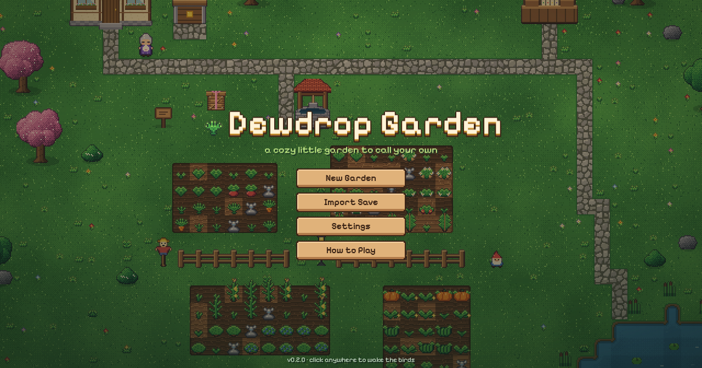
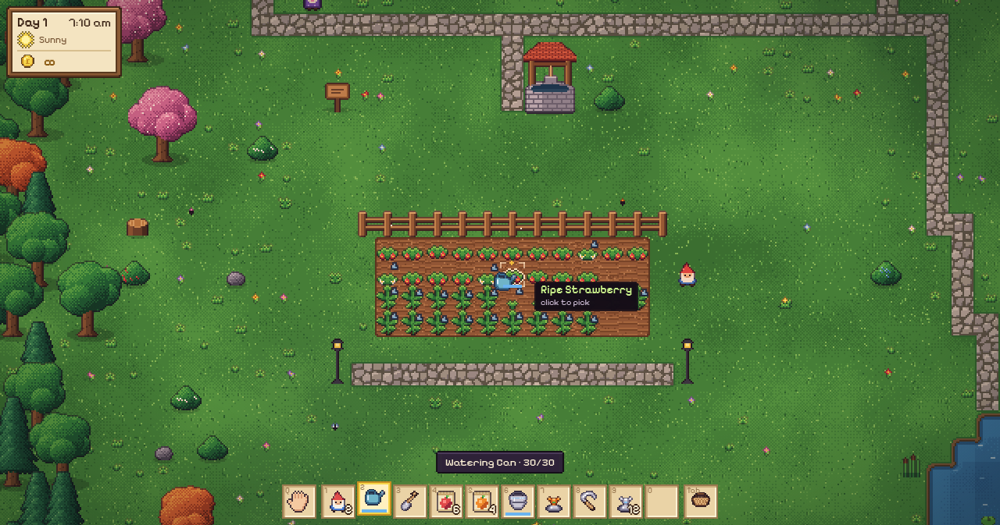
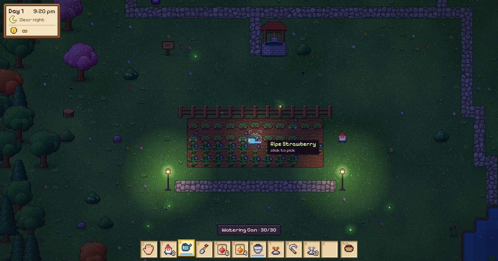

# 🌱 Dewdrop Garden

A cozy little pixel-art gardening sandbox that runs right in your browser. There's no character to walk around:
**your cursor is your hand.** Click and drag to till the soil, sweep seeds into rows, pour water, pick crops,
pull weeds, pry open delivery crates and drag your garden decorations wherever you like.
No goals, no timers, no pressure.



| Your garden | Cozy nights |
| --- | --- |
|  |  |

**Play it:** once GitHub Pages is enabled (see below) the game lives at `https://<your-username>.github.io/dewdrop-garden/`.

## Features

- **Hands-on, cursor-only play** — every tool becomes your cursor and animates as you use it (the hoe chops,
  the can tilts and pours, seeds shake out of the packet). Hold the button and sweep to work a whole row at once.
- **Unbox your stuff** — Granny's starter tools and every shop order arrive in a crate you knock open with a few clicks.
- **Pick things up** — with the bare hand you can drag sprinklers, fences, lamps, gnomes and crates to new spots.
- **Drag & drop selling** — drag a stack of crops from the toolbar onto the Shipping Bin.
- **Little touches everywhere** — hover tooltips show how far along each plant is, trees rustle and drop leaves
  when you poke them, the pond ripples, butterflies flee your hand, weeds sometimes hide seeds in their roots,
  and at night your hand carries a soft glow.

- **156 crops** — everyday veggies, berries, citrus, tropical fruit, herbs, mushrooms, a dozen kinds of flower
  and a whole set of glowing magical crops, all the way up to the **Celestial Lotus**, the best seed in the game.
- **Achievements** — 58 of them from easy to legendary, including turning the *entire* map into one giant garden.
- **Three plots of land** — the original garden, the Riverside Meadow (50,000 coins) and Blossom Hills (500,000 coins)
  with its golden koi, windmill and Wishing Well.
- **Fishing, fruit trees, beehives, golden tools**, a daily mailbox, campfires, lanterns and Mochi the cat.
- **Buy in bulk** — type exactly how many seeds you want (or hit Max) in Basil's shop.
- **Fish** swim in the pond and the meadow lake (and sometimes jump).
- **Real watering** — crops only grow while their soil is wet. Wet soil turns dark and dries out after about a day.
- **Tools** — hoe, watering can, water bucket (soaks 3×3), shovel and sickle (harvests 3×3).
- **Sprinklers** in three tiers that water your crops every morning, plus fertilizer for faster growth.
- **Decorate** with stone paths, auto-connecting fences, lamp posts that glow at night, scarecrows, gnomes and flower pots.
- **Day & night cycle** with warm sunsets, glowing windows and lamps, fireflies, butterflies and drifting cloud shadows.
- **Rainy days** that water everything for free.
- **Granny Willow's tutorial** walks new players through everything (and can be skipped).
- **Two modes:** *Cozy* (earn coins by selling crops) and *Sandbox* (everything is free).
- **Works with touch too** — tap to use, drag with two fingers to look around, pinch to zoom.
- **Generative lo-fi music**, birdsong, crickets and rain, all synthesized live. There are no audio files.
- **Autosave** to the browser, plus export/import of save files so you can move your garden between computers.

All the art is drawn by code (pixel art strings and procedural painters), so the whole game is a few hundred KB
and has no build step.

## Controls

| Input | Action |
| --- | --- |
| Left click | Use the selected tool · pick crops · open crates · talk / shop / sell / sleep |
| Click + drag | Sweep the tool over many tiles · with the hand: move placed things or drag the view |
| Right-drag, middle-drag or WASD | Look around |
| Right click | Put the tool away (back to the hand) |
| Scroll wheel / + − | Zoom (scroll down to zoom out; your zoom is remembered) |
| 1 – 0, Q | Pick a toolbar slot, or the hand |
| Drag a toolbar slot | Drop it on the Shipping Bin to sell, or on a tile to use it |
| Tab | Backpack |
| Esc | Pause menu (settings, save, how to play) |

## Running it locally

Browsers won't load JavaScript modules from `file://`, so serve the folder with any static web server:

```bash
python3 -m http.server 8000        # or: npm start
# then open http://localhost:8000
```

`npx serve .` or VS Code's *Live Server* also work.

**Debug mode:** open `http://localhost:8000/?debug` for test keys: **T** skips an hour, **G** ripens every crop,
**Y** adds 1000 coins, **R** toggles rain.

## Publishing on GitHub Pages

1. Create a new repository on GitHub (e.g. `dewdrop-garden`) and push this folder to its `main` branch:
   ```bash
   git add -A
   git commit -m "Dewdrop Garden"
   git branch -M main
   git remote add origin https://github.com/<your-username>/dewdrop-garden.git
   git push -u origin main
   ```
2. On GitHub go to **Settings → Pages** and set **Source** to **GitHub Actions**.
3. The included workflow (`.github/workflows/pages.yml`) deploys the game on every push to `main`.
   After a minute it's live at `https://<your-username>.github.io/dewdrop-garden/`. Share that link with friends!

Saves are stored per-browser, so everyone gets their own garden.

## Project layout

```
index.html, style.css        page shell + pixel-styled UI
src/main.js                  boot, main loop, title screen backdrop
src/config.js                tile size, map size, day length, etc.
src/core/                    input, synthesized audio, math helpers
src/art/palette.js           palette + string-art → sprite builder (auto-outlines)
src/art/sprites.js           hand-made pixel art: characters, crops, items
src/art/procedural.js        painted art: trees, cottage, market stall, well, decor
src/data/crops.js            crop stats (growth hours, prices, regrowth)
src/art/crops2.js            art for the expansion crops (plant families + fruit/bloom sprites)
src/data/crops_more.js       the 125 v1.2 crops (one row each; stats are derived from their order)
src/game/expansion.js        v1.2 gameplay: Blossom Hills, fishing, beehives, fruit trees, mail, wishing well, Mochi
src/game/achievements.js     achievement list + tracker
src/data/changelog.js        the update log shown on the title screen
src/game/leaderboard.js      optional global leaderboard, off by default (see docs/LEADERBOARD_SETUP.md)
src/data/items.js            every item + the shop lists
src/game/world.js            map layout & generation, save format for tiles
src/game/ground.js           pixel-level ground renderer (grass, soil, water, paths)
src/game/game.js             rules: cursor interaction, time, growth, tools, crates, shop
src/game/tutorial.js         Granny Willow's lessons
src/game/render.js           world drawing, lighting, weather
src/ui/                      DOM UI: HUD, hotbar, backpack, shop, menus, creator
tools/art-preview.html       shows every sprite, handy while editing art
```

### Adding a new crop

1. Add an entry to `CROPS` in `src/data/crops.js` (growth hours, seed price, sell price, packet colours).
2. Add its art to `CROP_ART` in `src/art/sprites.js`: `young`, `grown`, `ripe` and `icon` (16-wide rows;
   letters map to colours in `PAL` inside `src/art/palette.js`). Add `tall: true` for 24-row plants.
3. That's it. Seeds show up in the shop automatically. Check the art in `tools/art-preview.html`.

## Credits

- Game code & art: the Dewdrop Garden authors.
- Font: [Pixelify Sans](https://github.com/eifetx/Pixelify-Sans) by The Pixelify Sans Project Authors, SIL Open Font License
  (see `assets/fonts/OFL.txt`). The bundled copies are static Regular/SemiBold cuts with the "5" and "7" redrawn so
  numbers are easier to read.

## License

MIT, see [LICENSE](LICENSE).
